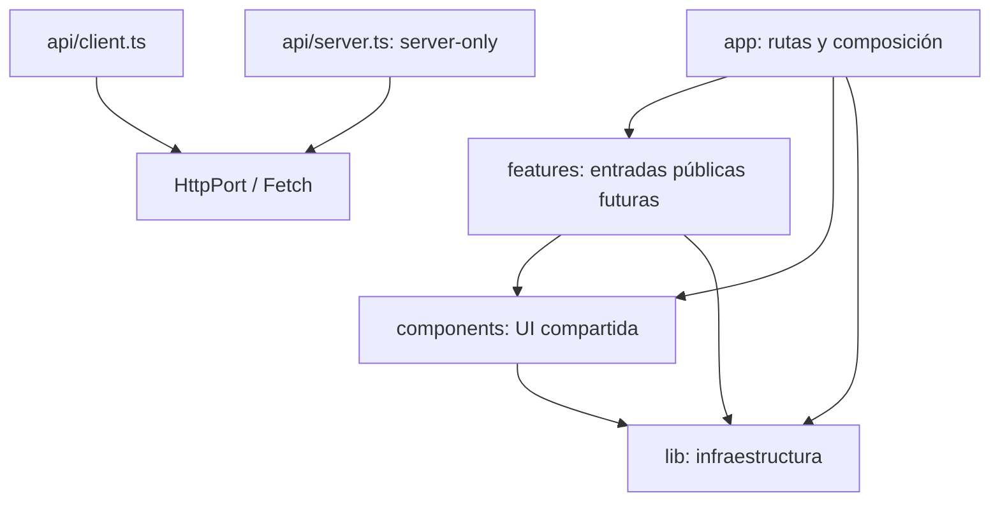

# Arquitectura inicial

## Alcance y referencia

Base técnica de Acciones UD, repositorio exclusivamente frontend. La referencia es
la **Especificación técnica de arquitectura frontend Acciones UD**, v1.0 del
2 de noviembre de 2026, recibida como adjunto. Sus ejemplos de endpoints, DTO,
eventos, sesión y flujos financieros son propuestas, no implementaciones aprobadas.
Esta entrega aplica sólo infraestructura. La raíz original se conserva; no hay
backend ni aplicación anidada, rutas funcionales, servicios ficticios o mocks activos
en la aplicación. MSW existe únicamente en pruebas.

## Responsabilidades y dependencias

`app/` compone rutas y proveedores; `features/` albergará módulos independientes;
`components/` es visual y reusable; `lib/` ofrece contratos e infraestructura;
`styles/` concentra tokens y globales. No se crean `auth/`, `telemetry/`, `public/`
ni subcarpetas vacías sin uso. Los archivos estáticos podrán añadirse a `public/`.

`npm run check:boundaries` construye un grafo a partir del AST y del resolvedor de
módulos de TypeScript, usando `tsconfig.json`. No hace búsquedas de texto sobre
imports. Usa el compilador ya instalado, sin añadir dependency-cruiser.

Comprueba imports relativos, alias, reexports, importaciones dinámicas literales,
`import type`, `require` y ciclos (incluidos los de tipos):

- `lib/` y `components/` no dependen de `app/` ni `features/`.
- Las funcionalidades no importan `app/`.
- Desde fuera de una funcionalidad sólo se accede a `index.ts`, `client.ts` o
  `server.ts`; dentro del mismo módulo se permiten imports relativos internos.
- Los imports dinámicos deben ser estáticos y analizables.
- Sólo los adaptadores importan la implementación Fetch. El resto consume el puerto.
- Sólo el transporte usa `fetch`; ESLint también comprueba sus llamadas.
- El acceso al entorno está centralizado en `lib/config/server.ts`.
- Los archivos compartidos no usan capacidades del navegador. Las entradas
  `client.ts`/`*.client.ts` requieren `client-only` o `use client`.
- Las entradas `server.ts`/`*.server.ts` requieren `server-only`. Los imports de
  servidor están prohibidos desde módulos compartidos y desde cualquier grafo
  cliente transitivo. Los imports sólo de tipos no se evalúan como código runtime.

El verificador analiza código de producción en `src/`; excluye pruebas y declaraciones.
Sus pruebas negativas generan pequeños grafos temporales, sin módulos ficticios
en `features/`. No es un sandbox de seguridad ni inspecciona internamente paquetes
de terceros. Next.js complementa el control con su build y los marcadores de entorno;
las dependencias nuevas requieren revisión. ESLint controla además React, hooks,
Next.js, tipos e imports; Prettier sólo formato.

## Cliente y servidor

RSC es el valor por defecto de `app/`. `providers.tsx` es una frontera `use client`.
`api/index.ts` exporta únicamente tipos compartidos y errores, nunca adaptadores de
servidor. Importar el adaptador adecuado explícitamente desde `api/client` o
`api/server`. Un barrel compartido no reexporta secretos ni código `server-only`.
Los Server Components pueden componer Client Components, pero un adaptador servidor
no consume adaptadores de navegador. `API_INTERNAL_ORIGIN` se valida al crear el
adaptador, no al importar el módulo o construir la página inicial.

## Estado remoto

`createQueryClient()` crea instancias independientes; `Providers` retiene una por
montaje con inicialización perezosa. No hay singleton compartido entre solicitudes
SSR, persistencia, Context con copias de datos remotos ni reanudación de mutaciones
persistidas. Una futura precarga RSC deberá crear otro cliente por solicitud.

Las consultas inactivas se recolectan a los 120 segundos; `staleTime` global es 0 y
cada recurso decidirá su frescura. GET idempotentes pueden reintentar hasta dos veces
ante transporte/408/500/502/503/504, con espera exponencial y jitter. 429 requiere
`Retry-After` válido de hasta 30 s; valores mayores o ausentes no se reintentan
automáticamente. 401, 403, contrato y cancelación nunca reintentan. El transporte
no reintenta. Las mutaciones tienen `retry: false` y `networkMode: always`: no se
encolan para ejecutarse automáticamente al recuperar conexión.

Cada módulo futuro debe usar claves `['private', sessionEpoch, accountId, recurso, ...]`.
`sessionEpoch` no es un token. Cambio de sesión/cuenta requerirá cancelar queries,
eliminar caché anterior y cerrar suscripciones antes de mostrar datos nuevos.
No usar `placeholderData` de otra identidad. Esto es una convención y extensión
pendiente: no se implementa ni simula una sesión en este bootstrap.

## Transporte HTTP

`HttpPort.request` soporta métodos genéricos, cuerpo JSON, query, señal de cancelación,
timeout y parser de `unknown`. Con `response: 'json'` el parser es obligatorio; con
`response: 'empty'` devuelve `void`, incluido 204/205/HEAD. Pedir JSON a una respuesta
sin contenido produce error de contrato, evitando devolver un valor tipado inexistente.

El navegador envía rutas relativas `/api/` y `credentials: same-origin`. Servidor
concatena únicamente el origen de despliegue validado y usa `credentials: omit`.
Ambos usan `cache: no-store`, rechazan redirecciones y rutas con URLs absolutas,
traversal, fragmentos o queries incrustadas. Los parámetros van en `query`; nunca
credenciales. El filtro de nombres sensibles es defensa adicional, no sustituye
la revisión de los valores. Las cabeceras opcionales se limitan a CSRF e idempotencia;
la correlación usa `requestId` validado y `X-Request-ID` como propuesta bootstrap.

`ApiError` distingue `http`, `transport` (incluido `metadata.timeout`), `cancelled`
y `contract`. JSON y Content-Type se validan; los errores HTTP conservan status
aunque el cuerpo sea inválido. Se acepta un subconjunto opcional RFC 9457 para
`application/problem+json`, sin inventar `code`, `errors` o DTO propios de FastAPI.
`detail` se considera texto no confiable: nunca renderizarlo como HTML. No se registran
cuerpos, cabeceras, cookies o variables de entorno en mensajes de error.

El timeout inicial es 10 s, configurable por solicitud. Cancelar o vencer un timeout
no prueba que el servidor haya cancelado un comando. Los flujos futuros deben tratar
esa incertidumbre con el protocolo de backend. No hay endpoints de negocio ni
Route Handlers que dupliquen FastAPI.

## WebSocket

`lib/realtime/index.ts` define únicamente ruta `/ws/v1`, alcance de sesión/cuenta,
contrato genérico de conexión/suscripción y función de limpieza. No hay implementación,
mensajes de wire inventados ni conexiones al iniciar la app. Tipos de suscripción
y evento serán parámetros suministrados por el contrato revisado.

El adaptador futuro deberá mantener una conexión por pestaña autenticada, compartir
suscripciones con conteo de referencias, validar eventos antes de entregarlos,
limitar colas, detectar duplicados/revisiones y huecos, y resincronizar snapshots.
Debe implementar limpieza, generación de callbacks por sesión/cuenta, heartbeat y
reconexión con backoff/jitter/límites, deteniéndose al expirar sesión. Backend debe
definir autenticación/Origin, mensajes, heartbeat, cursores, replay o barrera de
snapshot, tamaños, secuencias y errores. Los números propuestos en el documento
no se convierten aquí en compromisos de protocolo.

## Seguridad y despliegue

FastAPI será autoridad de sesión y autorización por recurso. Se prevén cookies
HttpOnly, Secure, SameSite (Lax propuesto), con nombre, duración y rotación por
acordar. SameSite no sustituye CSRF: la propuesta es token en memoria vinculado a
sesión/presesión y comprobación de Origin en backend. No hay autenticación ni permisos
simulados. No almacenar credenciales, tokens o caché privada en el navegador.

Hoy no se reenvía ninguna cookie desde Next.js. Cuando exista contrato se añadirá
selección explícita de **una única cookie de sesión**, nunca el encabezado Cookie
completo, Authorization entrante ni URLs controladas por usuarios. Secretos sin
`NEXT_PUBLIC_`, nunca props cliente ni logs. CSP, CSRF y cabeceras finales requieren
validación con el gateway real, no una política copiada que rompa hidratación.

Unidades independientes Next.js y FastAPI detrás de gateway HTTPS: páginas/assets a
Next.js, `/api/*` y `/ws/*` a FastAPI; soporte Upgrade para WSS. No hay rewrites que
expongan el origen interno ni proxy de negocio en Next.js. En local la página no
necesita gateway; las integraciones futuras sí. HTML/RSC/API privados deberán usar
private/no-store también en gateway. Sólo assets públicos versionados tendrán caché
larga. Ver [despliegue](../development/deployment.md).
